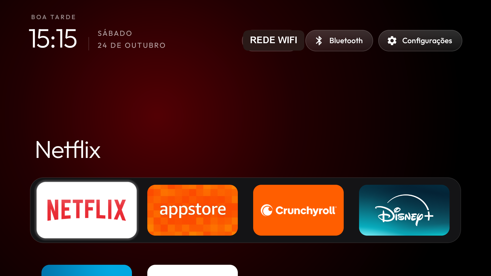
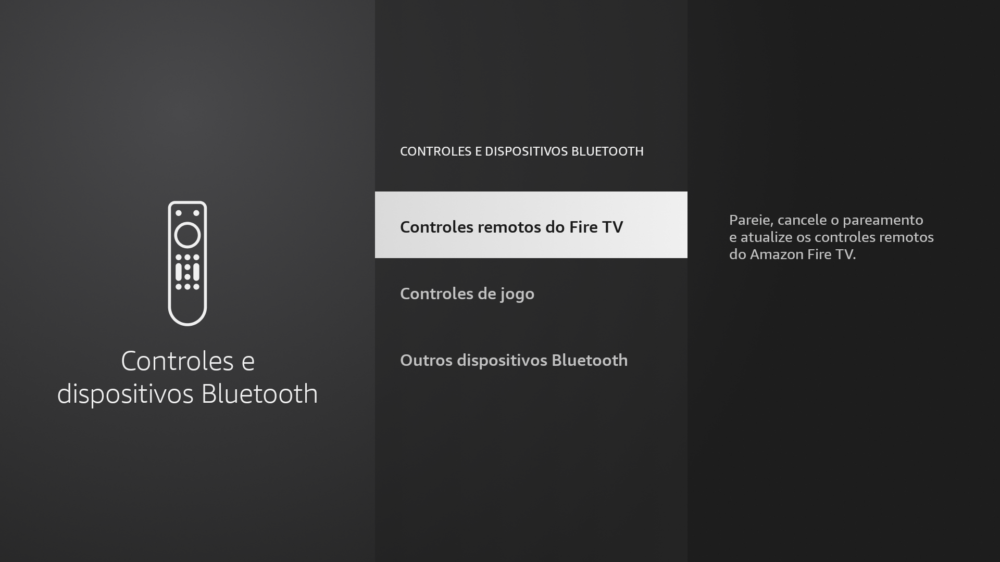

# Fire TV Stick Lite (sheldon) — root + debloat + clean launcher

*[Leia em português](README.pt-BR.md)*

A full write-up of rooting an Amazon Fire TV Stick Lite, removing bloatware, and replacing the
stock launcher with [CleanYourTV](https://github.com/Gathin23/cleanyourtv), including two small
launcher patches: showing the Amazon Appstore (and other non-"TV" packages) as a tile with its
real artwork, and a dedicated Bluetooth/Controllers button in the top bar.

**Have a different Fire TV model or Fire OS version?** [`PROMPT.md`](PROMPT.md) is written to
paste into an AI coding agent and have it check your specific device's compatibility first,
rather than assuming it matches this exact one.

Everything here was done against the **exact device and firmware build below** — if you have the
same (or very close) model/build, this should apply directly. If you're on something else, it may
still help, but check compatibility first (see [Root](#1-root-ghostlock)).

## Exact device tested

| | |
|---|---|
| **Model** | Amazon Fire TV Stick Lite (2020) |
| **Model number (box/device)** | AFTSS |
| **Codename** | `sheldon` |
| **Fire OS** | 7.7.1.7 |
| **Build** | `PS7717.5741N` |
| **Incremental** | `0036408028416` |
| **Android base** | 9 (Pie) |
| **Kernel** | `Linux 4.4.162+` |
| **SoC** | MediaTek MT8695D |

If `adb shell getprop ro.build.fingerprint` on your device shows `sheldon` and `PS7717.5741N`
(or a close build on the list in [GhostLock's `4.4` branch README](https://github.com/R0rt1z2/GhostLock/tree/4.4)),
this guide applies to you directly.

## What this does

1. Roots the device (temporarily, lost on reboot — this is normal for this exploit)
2. Debloats ~50 Amazon telemetry/ads/bloatware packages (`pm disable-user`, nothing removed from
   `/system`)
3. Removes a few extra apps the owner didn't want (Luna cloud gaming, the Fire TV troubleshooting
   app) and a leftover third-party launcher
4. Replaces the stock Amazon launcher with a self-built [CleanYourTV](https://github.com/Gathin23/cleanyourtv),
   patched so:
   - The Amazon Appstore shows as a tile with its **real** artwork (cropped straight from Amazon's
     own "Your Apps & Games" screen, not a generic icon) and opens on its Featured/home page, not
     the "My Apps" grid
   - **Bluetooth & Controllers** gets its own dedicated top-bar button, separate from the general
     Settings button (which Fire OS's own stock-launcher-dependent settings fallback would
     otherwise break once you disable the stock launcher — see [Settings pill fix](#Settings-pill-fix))
5. Blocks Amazon's OTA updater so none of this gets silently reverted

## Screenshots

| Home screen | Bluetooth & Controllers (via the new button) |
|---|---|
|  |  |

## 1. Root (GhostLock)

This uses [R0rt1z2/GhostLock](https://github.com/R0rt1z2/GhostLock), **branch `4.4`** — not the
`main`/`5.10` branch, which today only targets different, newer Fire OS 8 hardware (Fire Max 11,
Fire TV Stick 4K Max 2nd Gen). The `4.4` branch is a separate, MediaTek-MT8695/8696-specific
exploit (adapted from CVE-2026-43499 in CyberMeowfia) targeting exactly the `sheldon`/`sheldonp`
family on Fire OS 7, with a hardware-tested profile for build `PS7717.5741N` (ours) baked into
`src/gl_profiles_embedded.h`.

```sh
git clone https://github.com/R0rt1z2/GhostLock.git
cd GhostLock
git checkout 4.4
make NDK=/path/to/android-ndk-r27d   # ARM v7a toolchain, Android NDK r27d (or override CC=)
./root.sh                            # Linux/macOS; reboots the device, retries up to 15x
```

### Windows / Git Bash

`root.sh` assumes a POSIX host (Linux/macOS `adb` paths) and blocks forever on
`adb wait-for-device` after a reboot for a **network**-connected (Wi-Fi ADB) device, since that
command never re-arms a TCP transport on its own — you need to actively `adb connect` again.
[`root/root_win.sh`](root/root_win.sh) in this repo is a Windows/Git-Bash-safe rewrite of the same
protocol that:

- Actively re-`adb connect`s after every reboot instead of blocking on `wait-for-device`
- Sets `MSYS_NO_PATHCONV=1` / `MSYS2_ARG_CONV_EXCL="*"` so Git Bash doesn't rewrite the **remote**
  Android path `/data/local/tmp/gl/...` into a bogus local Windows path (`secure_mkdirs failed`)
- Resolves the **local** binary path with `pwd -W` instead, so it's still a real Windows path for
  `adb.exe` (a native Win32 binary) to read
- Skips the `[ -x ...]` executable-bit check on the compiled ARM ELF binary, which NTFS/Git-Bash
  can't satisfy even after `chmod +x` (irrelevant anyway — the real exec bit is set on-device after
  push)

```sh
TRIES=15 sh root/root_win.sh
```

Once rooted, `su` works from any fresh `adb shell` until the next reboot — no daemon/wrapper needed.

## 2. Debloat

[`debloat/sheldon_lite_fireos7.txt`](debloat/sheldon_lite_fireos7.txt) is the Fire TV Stick Lite
debloat list from [saisarathbb/firetv-clean-root](https://github.com/saisarathbb/firetv-clean-root)
(credited there to the broader [Gathin23/cleanyourtv](https://github.com/Gathin23/cleanyourtv)
debloat-list database). Applied with plain `pm disable-user --user 0 <pkg>`, one call per package,
over a fresh rooted `adb shell` — **disable, never uninstall**, for anything under `/system`.

```sh
while read -r pkg; do
  pkg="${pkg%%#*}"; [ -z "$pkg" ] && continue
  adb shell "su -c 'pm disable-user --user 0 $pkg'"
done < debloat/sheldon_lite_fireos7.txt
```

## 3. Launcher: build + patches

The toolkit at `firetv-clean-root` ships a **prebuilt** CleanYourTV APK that turned out to predate
the `library_apps`/`launch_actions`/`app_banners`/`dock_apps` config-overlay features entirely (no
matching strings in its `classes.dex`) — none of our `config.json` runtime overrides had any
effect on it. Building the **current** [Gathin23/cleanyourtv](https://github.com/Gathin23/cleanyourtv)
`launcher/` from source (`./gradlew assembleRelease`, needs JDK 17 + Android SDK platform 34 +
build-tools 34.0.0) picked up those features immediately.

Two small patches on top of stock `cleanyourtv` (see [`launcher-patch/cleanyourtv.patch`](launcher-patch/cleanyourtv.patch)
for the full diff):

### Non-leanback tiles with their real artwork

Fire OS's own apps (the Appstore, Settings) don't declare `CATEGORY_LEANBACK_LAUNCHER` — they were
built for Amazon's own stock launcher, not the generic Android TV convention CleanYourTV (by
design) reads. `dock_apps` / `library_apps` already let you pull in a `CATEGORY_LAUNCHER` app that
isn't leanback, and `launch_actions` (`pkg=action`) already let you override what a tile's tap
does — e.g. the Appstore's plain launch activity is `.grid.AppsGridLauncherActivity` ("Your Apps &
Games"), not the Featured/storefront home; `com.amazon.venezia.ade.FEATURED_LAUNCH` opens the real
one.

The banner is [the real artwork](launcher-patch/drawable/banner_venezia.png), cropped directly out
of a `screencap` of Amazon's own "Your Apps & Games" screen (not a recreation) at the same 16:9
aspect ratio CleanYourTV's own tile (`180dp × 101dp`, see `item_app.xml`) expects — a close-but-off
aspect ratio on a `centerCrop` `ImageView` is what reads as "doesn't quite fill the tile".

### Dedicated Bluetooth/Controllers button, and the Settings-pill fix

The Settings app (`com.amazon.tv.settings.v2`) has **no** `CATEGORY_LAUNCHER` activity at all —
only specific sub-screens reachable by action, so it can never get a tile via the mechanism above
no matter what config you throw at it (confirmed by reading `AppAdapter.reload()`: a tile is only
created from a `queryIntentActivities(MAIN, LAUNCHER)` hit). `AppAdapter.java` is patched to also
synthesize a tile-entry (using the package's own icon/label via `PackageManager.getApplicationInfo`)
for any `library_apps`/`dock_apps` package that has a `launch_actions` override but no resolvable
launcher activity — `launch()` always builds the `launch_actions` intent and swaps it in *before*
ever using the synthetic placeholder component, so nothing broken is ever actually started.

That path still only gets you a grid *tile*, though — not a top-bar pill like Wi-Fi/Settings. A
dedicated `btnBluetooth` pill (`activity_main.xml` + `MainActivity.java`) was added instead,
styled identically to the existing ones, firing `android.settings.CONTROLLERS_SETTINGS` explicitly
on click.

<a id="Settings-pill-fix"></a>**Why the Settings pill itself needs a fix too:** CleanYourTV's
`SystemSettings.intent()` already works around Fire OS binding `android.settings.SETTINGS` to a
CTS-compliance stub that opens nothing (`CTSDummySettingsHandler`) — it falls back to the first
installed component in `settings_fallback_components`. Stock config.xml's Fire OS entry there is
`com.amazon.tv.launcher/...MainSettingsActivity` — i.e. **the stock Amazon launcher itself**, which
this whole guide disables in step 4. Once disabled, that fallback silently resolves to a dead
component and the Settings pill shows "not available on this TV". Pointing that same entry at
`com.amazon.tv.settings.v2/com.amazon.tv.settings.v2.tv.device.DeviceActivity` instead restores it.

### Build & install

```sh
cd cleanyourtv/launcher
./gradlew assembleRelease
# sign with your own keystore (any key; only needs to stay the same across your own updates)
apksigner sign --ks your.jks --out app-release-signed.apk app-release-aligned.apk
adb shell "su -c 'pm uninstall --user 0 com.gathin.tvhome'"   # only if a different key was installed before
adb install -r app-release-signed.apk
adb shell "su -c 'pm disable-user --user 0 com.amazon.tv.launcher'"
adb shell "su -c 'cmd package set-home-activity --user 0 com.gathin.tvhome/.MainActivity'"
```

## 4. Block OTA

```sh
for pkg in com.amazon.device.software.ota com.amazon.device.software.ota.override com.amazon.tv.forcedotaupdater.v2; do
  adb shell "su -c 'pm disable-user --user 0 '$pkg"
done
```

## Reverting

The root itself is lost on the next reboot automatically. Everything else (debloat, launcher,
app removals, OTA block) is persistent Android package-manager state, not tied to root — to
revert, `pm enable`/reinstall the same packages, which needs root again (protected-package
restrictions apply both ways).

## Credits

- [R0rt1z2/GhostLock](https://github.com/R0rt1z2/GhostLock) (`4.4` branch) — the kernel root
  exploit itself, with credits onward to [CyberMeowfia](https://github.com/NebuSec/CyberMeowfia),
  [IonStackQuest3](https://github.com/F-19-F/IonStackQuest3) and
  [gitchw/ghostlock-cve-2026-43499](https://github.com/gitchw/ghostlock-cve-2026-43499)
- [saisarathbb/firetv-clean-root](https://github.com/saisarathbb/firetv-clean-root) — the debloat
  list and the idea of pairing a root exploit with CleanYourTV on Fire OS
- [Gathin23/cleanyourtv](https://github.com/Gathin23/cleanyourtv) — the launcher itself

## Disclaimer

Rooting involves a kernel exploit and low-level package-manager changes. The exploit itself is
in-memory only (no bootloader/partition writes), and everything here uses `pm disable-user` rather
than touching `/system`, but this is still "at your own risk" territory — see the disclaimers in
the credited repos above.
